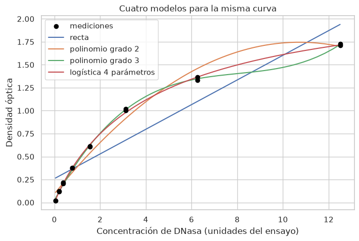
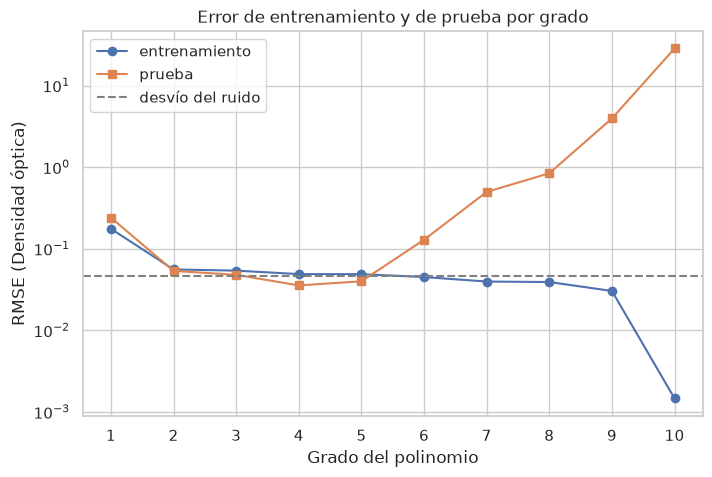

[Español](README.md) · **English**

# AI-Assisted Data Analysis Workshop for Chemical Sciences

Materials for modules 7 and 8 of the graduate course **"Aplicaciones de herramientas de Inteligencia Artificial en Investigación Científica"** (*Applications of Artificial Intelligence Tools in Scientific Research*), Faculty of Chemical Sciences, National University of Córdoba, Argentina, 2026. The course materials are in Spanish.

## Who it is for

PhD and master's students in Chemical Sciences **who do not code**. In each class they work with an AI assistant and Python notebooks: given a task, they write the prompt, read the code the assistant generates, run it and **verify** the result. Verification is part of every activity, because the assistant can be confidently wrong.

## Modules

| Module | Topic | Status |
|---|---|---|
| [7](modulo-7/) | Python with AI assistance, descriptive statistics, visualization and regression: calibration, curve fitting, overfitting and metrics | First version |
| 8 | Machine learning workflow: decision trees, random forests, K-Means, PCA and neural networks | In preparation |

Each module has two notebooks: `guia.ipynb`, for students, with tasks, hints and space to work; and `resuelto.ipynb`, for instructors, with solutions, reference prompts and interpretations. The student notebook is generated automatically from the instructor notebook.

## Module 7 at a glance

The whole class uses real **ELISA calibration data** (the DNase dataset: 11 assay runs, 8 standard concentrations, duplicate readings):

- **Environment and debugging:** load the data from a file and from a URL; read a real error message and fix it with the assistant.
- **Dirty data:** find 4 readings altered on purpose. A boxplot flags 10 suspicious readings, 6 of which are genuine; comparing the duplicate readings within each run isolates exactly the 4 altered ones.
- **Publication-ready figure:** adapt a plot to a journal's figure guidelines (ACS in the example) and check the saved file against the official guidelines.
- **Calibration and inverse prediction:** a straight line over the linear range (slope 0.380, R² = 0.980) and the concentration of an unknown sample.
- **Curve fitting:** the four-parameter logistic, the standard model for immunoassays, lowers the RMSE from 0.206 (straight line) to 0.017. A third-degree polynomial reaches a similar RMSE with a physically meaningless shape.
- **Overfitting:** the test error is lowest at degree 4 (RMSE 0.036) and explodes at degree 10 (RMSE 28), where the training R² is 1.000 and the test R² is −1932.

<p align="center">
  
  
</p>

The overfitting block uses 18 **simulated** points generated from the curve and noise of the real data, because each real run has only 8 distinct concentrations. This is stated in the notebook and in [`data/README.md`](data/README.md).

## How to run

The course uses **VS Code** with the **OpenCode** assistant:

1. Clone or download this repository and open the folder in VS Code.
2. Create a Python 3.12 environment and install the libraries:
   ```bash
   pip install -r requirements.txt
   ```
3. Open `modulo-7/guia.ipynb`, select that environment as the kernel and ask OpenCode for the code of each task.

Without VS Code, the notebooks can also be opened with `jupyter notebook`.

## Repository structure

```
modulo-7/       module 7 notebooks (student and instructor versions) and a README with the instructor checklist
data/           datasets, with source, license and description in data/README.md
herramientas/   scripts that generate the student notebook and the dataset with anomalies
docs/           course outline and the figures in this README
```

## Data and licenses

The code and course materials are released under the [MIT license](LICENSE).

The datasets have their own provenance and licenses. DNase comes from Davidian and Giltinan (1995) and is distributed with R (`datasets` package). Details for each dataset, and the description of the simulated and altered data, are in [`data/README.md`](data/README.md) (in Spanish).
