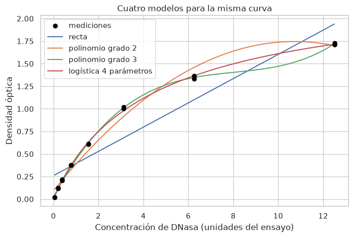
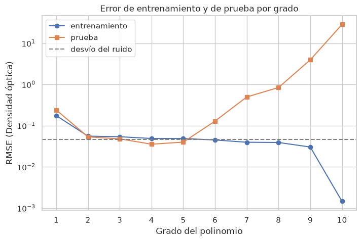
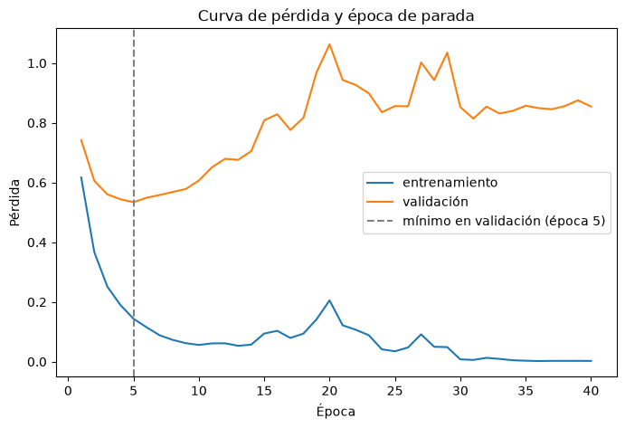
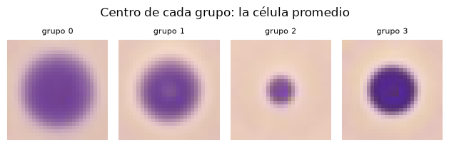

**Español** · [English](README.en.md)

# Taller de IA para análisis de datos en Ciencias Químicas

Materiales de los módulos 7 y 8 del curso de posgrado **"Aplicaciones de herramientas de Inteligencia Artificial en Investigación Científica"** (Facultad de Ciencias Químicas, Universidad Nacional de Córdoba, ciclo 2026).

## A quién va dirigido

Estudiantes de doctorado y maestría en Ciencias Químicas **que no programan**. En cada clase trabajan con un asistente de IA y notebooks de Python: a partir de una consigna escriben el prompt, leen el código que genera el asistente, lo ejecutan y **verifican** el resultado. La verificación es parte de cada actividad, porque el asistente puede equivocarse con total seguridad.

## Módulos

| Módulo | Tema | Estado |
|---|---|---|
| [7](modulo-7/) | Python con asistencia de IA, estadística descriptiva, visualización y regresión: calibración, ajuste de curvas, sobreajuste y métricas | Primera versión |
| [8](modulo-8/) | Aprendizaje automático con imágenes de células sanguíneas: clasificadores, sobreajuste, agrupamiento con K-Means y PCA | Primera versión |

Cada módulo tiene las diapositivas de la teoría (`teoria.pdf`) y dos notebooks: `guia.ipynb`, para estudiantes, con consignas, pistas y espacios para completar; y `resuelto.ipynb`, para docentes, con soluciones, prompts de referencia e interpretaciones. La guía se genera automáticamente desde el resuelto.

## Módulo 7 en una mirada

Toda la clase usa datos reales de **calibración de un ensayo ELISA** (conjunto DNase: 11 corridas, 8 concentraciones patrón, lecturas por duplicado):

- **Entorno y depuración:** cargar los datos desde un archivo y desde una URL; leer un error real y corregirlo con el asistente.
- **Datos sucios:** encontrar 4 lecturas alteradas a propósito. Un boxplot marca 10 lecturas sospechosas, y 6 de ellas son reales; comparar los duplicados de cada corrida aísla exactamente las 4 alteradas.
- **Figura para publicar:** adaptar un gráfico a las normas de figuras de una revista (en el ejemplo, ACS) y verificar el archivo contra la guía oficial.
- **Calibración:** recta en el tramo lineal (pendiente 0,380, R² = 0,980) y lectura de su pendiente, ordenada y R².
- **Ajuste de curvas:** la logística de cuatro parámetros, el modelo estándar de los inmunoensayos, reduce el RMSE de 0,206 (recta) a 0,017. Un polinomio de grado 3 logra un RMSE parecido con una forma sin sentido físico.
- **Sobreajuste:** el error de prueba es mínimo en grado 4 (RMSE 0,036) y se dispara en grado 10 (RMSE 28), donde el R² de entrenamiento es 1,000 y el de prueba es −1932.

<p align="center">
  
  
</p>

El bloque de sobreajuste usa 18 puntos **simulados** a partir de la curva y el ruido de los datos reales, porque cada corrida real tiene solo 8 concentraciones distintas. Está declarado en el notebook y en [`data/README.md`](data/README.md).

## Módulo 8 en una mirada

Toda la clase usa **imágenes de microscopía de células sanguíneas** (BloodMNIST: 28 × 28 píxeles en color, 8 tipos celulares). Se entrena con una submuestra balanceada de 5000 imágenes y se evalúa con las 3421 imágenes de prueba oficiales, midiendo con F1 macro:

- **Primer clasificador:** la regresión logística llega a F1 = 1,000 en entrenamiento y 0,704 en prueba. La matriz de confusión muestra que los errores se concentran entre células grandes de núcleo voluminoso, que a esta resolución se parecen mucho.
- **Árboles y bosques:** un árbol sin límite memoriza y queda en 0,574; un bosque de 100 árboles sube a 0,794. El F1 de prueba del árbol deja de mejorar a partir de la profundidad 8.
- **Redes y curva de pérdida:** la pérdida de validación es mínima en la época 5 y después sube, aunque el F1 casi no cambia: la red se vuelve demasiado segura. Sin estandarizar los píxeles, el F1 de prueba baja de 0,793 a 0,718.
- **Agrupamiento:** sin usar las etiquetas, K-Means separa 4 tipos celulares bien distintos con un ARI de 0,71, y el centro de cada grupo se puede dibujar como una «célula promedio». Con los 8 tipos el ARI baja a 0,34, y ni el codo ni la silueta encuentran solos la cantidad de tipos.
- **PCA (optativo):** 37 componentes explican el 80 % de la varianza de las 2352 columnas de cada imagen.

<p align="center">
  
  
</p>

## Cómo ejecutar

En el curso se trabaja con **VS Code** y el asistente **OpenCode**:

1. Clonar o descargar este repositorio y abrir la carpeta en VS Code.
2. Crear un entorno de Python 3.12 e instalar las librerías:
   ```bash
   pip install -r requirements.txt
   ```
3. Para el módulo 8, descargar las imágenes (35 MB, no están en el repositorio):
   ```bash
   python herramientas/descargar_bloodmnist.py data/bloodmnist.npz
   ```
4. Abrir la guía del módulo (`modulo-7/guia.ipynb` o `modulo-8/guia.ipynb`), elegir ese entorno como *kernel* y pedirle a OpenCode el código de cada consigna.

Sin VS Code, los notebooks también se pueden abrir con `jupyter notebook`.

## Estructura

```
modulo-7/       diapositivas y notebooks del módulo 7 (guía y resuelto), y su README con el checklist docente
modulo-8/       lo mismo para el módulo 8
data/           conjuntos de datos, con fuente, licencia y descripción en data/README.md
herramientas/   scripts para generar la guía y los datos con anomalías, y para descargar BloodMNIST
docs/           figuras de este README
```

## Datos y licencias

El código y los materiales del curso se distribuyen bajo la [licencia MIT](LICENSE).

Los conjuntos de datos tienen su propia procedencia y licencia. DNase proviene de Davidian y Giltinan (1995) y se distribuye con R (paquete `datasets`). BloodMNIST proviene de MedMNIST v2 (Yang et al., 2023), a partir de las imágenes de Acevedo et al. (2020), con licencia CC BY 4.0. Los detalles de cada conjunto, y la descripción de los datos simulados y alterados, están en [`data/README.md`](data/README.md).
